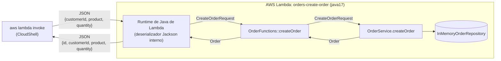
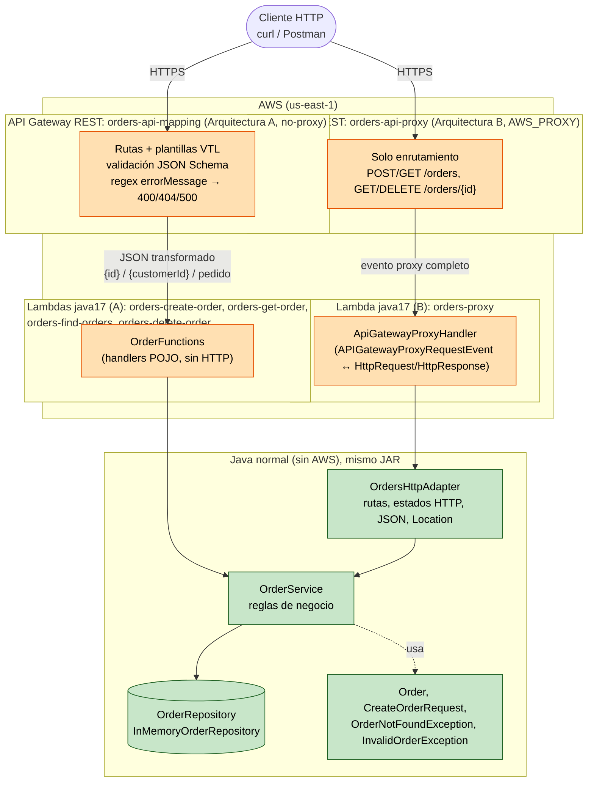
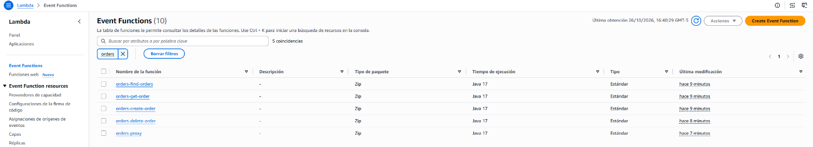
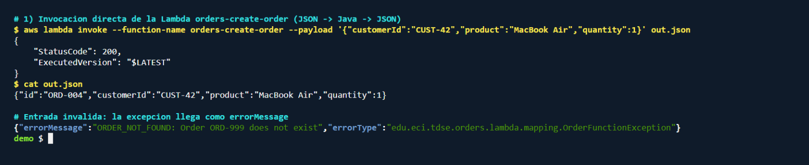
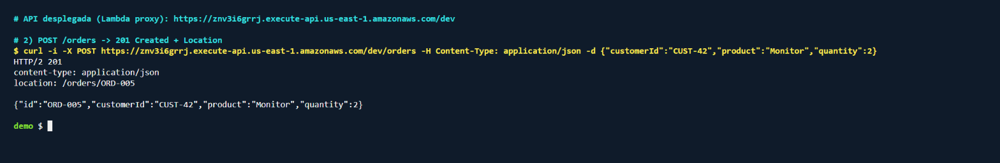
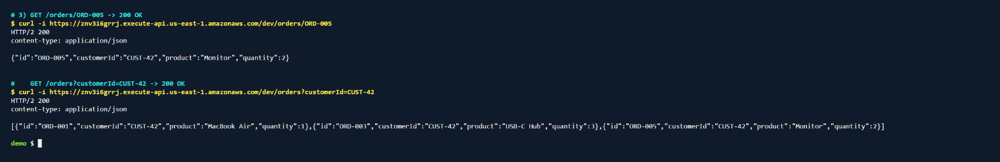
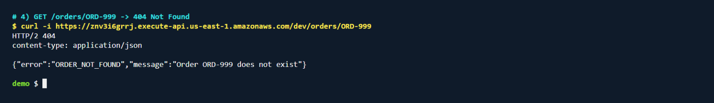
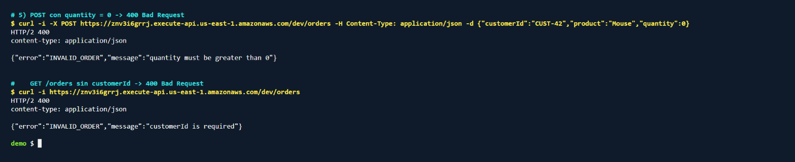
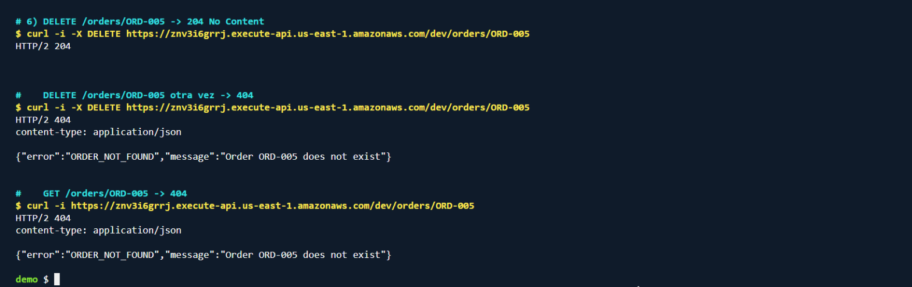

# LAB09_TDSE_Workshop-Designing-a-Serverless-REST-API-with-AWS-Lambda-and-API-Gateway

Order Management API implementada en Java 17 + Maven y desplegada en AWS Lambda + Amazon API Gateway,
con dos arquitecturas distintas para exponer las mismas funciones:

- **Arquitectura A**: API Gateway con integración *no-proxy* (plantillas de mapeo VTL). API Gateway extrae
  parámetros, transforma peticiones/respuestas y decide los códigos HTTP.
- **Arquitectura B**: API Gateway con integración *Lambda proxy*. Una Lambda con un adaptador HTTP delgado
  decide códigos de estado, cabeceras y serialización.

La lógica de aplicación (`OrderService`) es Java puro y es la misma en ambas arquitecturas.

## Contenido

1. [Estructura del proyecto](#1-estructura-del-proyecto)
2. [Diseño del contrato de la API](#2-diseño-del-contrato-de-la-api)
3. [Parte I: aplicación en Java puro y Checkpoint 1](#3-parte-i-aplicación-en-java-puro)
4. [Parte II: Java en AWS Lambda y Checkpoint 2](#4-parte-ii-función-java-en-aws-lambda)
5. [Partes III y IV: API Gateway con plantillas de mapeo y Checkpoint 3](#5-partes-iii-y-iv-api-gateway-con-plantillas-de-mapeo-arquitectura-a)
6. [Parte V: integración Lambda proxy y adaptador HTTP](#6-parte-v-integración-lambda-proxy-arquitectura-b)
7. [Comparación de las dos arquitecturas](#7-comparación-de-las-dos-arquitecturas)
8. [Desarrollo asistido por IA y crítica del agente](#8-desarrollo-asistido-por-ia)
9. [Reto final: DELETE /orders/{id}](#9-reto-final-delete-ordersid)
10. [API final y diagrama de arquitectura](#10-api-final-y-diagrama-de-arquitectura)
11. [Cómo construir, probar y desplegar](#11-cómo-construir-probar-y-desplegar)

---

## 1. Estructura del proyecto

```
.
├── pom.xml
├── README.md
├── events/                      # entradas de Lambda y eventos reales de API Gateway (proxy)
├── infra/                       # scripts de despliegue (AWS CLI) y configuración de API Gateway
│   ├── common.sh
│   ├── deploy-architecture-a.sh # Lambdas POJO + API REST no-proxy con plantillas de mapeo
│   ├── deploy-architecture-b.sh # Lambda proxy + API REST con integración AWS_PROXY
│   ├── models/create-order.schema.json
│   └── templates/*.vtl          # plantillas de mapeo de petición y respuesta
├── docs/
│   ├── examples/                # peticiones y respuestas reales contra las APIs desplegadas
│   └── evidence/                # capturas de la consola de AWS
└── src/
    ├── main/java/edu/eci/tdse/orders/
    │   ├── domain/              # Order, CreateOrderRequest, excepciones de negocio      (Java puro)
    │   ├── application/         # OrderService, OrderRepository, repositorio en memoria  (Java puro)
    │   ├── http/                # OrdersHttpAdapter, HttpRequest, HttpResponse           (HTTP, sin AWS)
    │   └── lambda/
    │       ├── mapping/         # OrderFunctions: handlers POJO de la arquitectura A     (Lambda)
    │       └── proxy/           # ApiGatewayProxyHandler: handler de la arquitectura B   (Lambda + API Gateway)
    └── test/java/...            # pruebas JUnit 5 de cada capa
```

## 2. Diseño del contrato de la API

El contrato se definió antes de escribir código.

### Representación de un pedido

```json
{
  "id": "ORD-001",
  "customerId": "CUST-42",
  "product": "MacBook Air",
  "quantity": 1
}
```

### Representación de los errores

Todas las respuestas de error usan el mismo documento JSON:

```json
{
  "error": "ORDER_NOT_FOUND",
  "message": "Order ORD-999 does not exist"
}
```

| Código de error (`error`) | Significado                                       | Estado HTTP |
|---------------------------|---------------------------------------------------|-------------|
| `INVALID_ORDER`           | Datos de entrada inválidos o faltantes            | 400         |
| `ORDER_NOT_FOUND`         | El pedido solicitado no existe                    | 404         |
| `INTERNAL_ERROR`          | Error inesperado (sin detalles internos expuestos)| 500         |

### Operaciones

| Operación | Método y URL | Parámetros | Cuerpo de la petición | Éxito | Errores |
|-----------|--------------|------------|-----------------------|-------|---------|
| Crear un pedido | `POST /orders` | — | `{"customerId","product","quantity"}` | `201 Created` + pedido creado (con `id`) | `400 INVALID_ORDER` (campo faltante, `quantity < 1`, JSON inválido), `500 INTERNAL_ERROR` |
| Consultar un pedido | `GET /orders/{id}` | path: `id` | — | `200 OK` + pedido | `404 ORDER_NOT_FOUND`, `500 INTERNAL_ERROR` |
| Buscar pedidos de un cliente | `GET /orders?customerId={customerId}` | query: `customerId` (obligatorio) | — | `200 OK` + arreglo de pedidos (vacío si el cliente no tiene pedidos) | `400 INVALID_ORDER` (falta `customerId`), `500 INTERNAL_ERROR` |
| Eliminar un pedido (reto final) | `DELETE /orders/{id}` | path: `id` | — | `204 No Content` sin cuerpo | `404 ORDER_NOT_FOUND`, `500 INTERNAL_ERROR` |

Reglas de validación de `POST /orders`: `customerId` y `product` obligatorios y no vacíos; `quantity` entero
obligatorio y mayor que 0. El `id` lo genera el servidor (`ORD-004`, `ORD-005`, ...), el cliente no lo envía.

Datos predefinidos (cada entorno de Lambda arranca con ellos, porque la memoria no es persistente):

| id | customerId | product | quantity |
|----|------------|---------|----------|
| ORD-001 | CUST-42 | MacBook Air | 1 |
| ORD-002 | CUST-7 | Keyboard | 2 |
| ORD-003 | CUST-42 | USB-C Hub | 3 |

### Preguntas de diseño

**¿Cuáles son los recursos de la API?**
Hay un único tipo de recurso, el **pedido**, expuesto de dos formas: la **colección** `/orders` (crear y buscar
pedidos) y el **elemento** `/orders/{id}` (consultar y, en el reto final, eliminar un pedido concreto).

**¿Por qué `/orders/{id}` para obtener un pedido?**
Porque el `id` identifica de forma única a un recurso: es parte de *qué* recurso se pide, no un filtro. Con el
identificador en el path, cada pedido tiene una URL estable que puede devolverse en la cabecera `Location`,
enlazarse, cachearse y usarse con otros métodos (`GET`, `DELETE`) sobre la misma URL.

**¿Por qué `customerId` es un query parameter en la búsqueda?**
Porque no identifica un recurso, sino que **filtra** la colección `/orders`. El resultado es un subconjunto (que
puede estar vacío) de la colección. Como query parameter, además, se pueden añadir otros filtros opcionales
después (`?customerId=...&product=...`) sin cambiar la estructura de las URLs. Una alternativa válida sería
`/customers/{customerId}/orders`, pero introduciría un recurso `customers` que esta API no administra.

**¿Qué debe devolver `POST /orders` cuando crea un pedido?**
`201 Created`, el pedido creado en el cuerpo (incluyendo el `id` generado por el servidor) y la cabecera
`Location: /orders/{id}` con la URL del nuevo recurso.

**¿Qué debe devolver la API cuando un pedido no existe?**
`404 Not Found` con el documento de error `{"error": "ORDER_NOT_FOUND", "message": "Order ORD-999 does not exist"}`.
En cambio, buscar los pedidos de un cliente que no tiene pedidos **no** es un error: devuelve `200 OK` con `[]`.

**¿Qué información debe contener una respuesta de error?**
Un **código de error estable y legible por máquinas** (`error`), para que los clientes puedan reaccionar
programáticamente sin interpretar texto, y un **mensaje legible por humanos** (`message`) que explique el problema.
No debe contener trazas de pila, nombres de clases ni detalles de infraestructura. El estado HTTP complementa al
código de error, no lo reemplaza.

## 3. Parte I: aplicación en Java puro

La funcionalidad se implementó sin HTTP, sin API Gateway, sin Spring Boot y sin servidor web:

```java
public class OrderService {
    public Order createOrder(CreateOrderRequest request);   // lanza InvalidOrderException
    public Order getOrder(String id);                       // lanza OrderNotFoundException
    public List<Order> getOrdersByCustomer(String customerId);
}
```

- `Order`: entidad inmutable.
- `CreateOrderRequest`: datos de entrada para crear un pedido.
- `OrderRepository` / `InMemoryOrderRepository`: almacenamiento en memoria (`ConcurrentHashMap`), detrás de una
  interfaz para que el servicio no dependa del tipo de almacenamiento.
- `OrderNotFoundException` / `InvalidOrderException`: errores de negocio con un código estable (`ORDER_NOT_FOUND`,
  `INVALID_ORDER`). No contienen estados HTTP.

### Pruebas locales

`OrderServiceTest` cubre: creación de un pedido válido, consulta de un pedido existente, pedido inexistente,
búsqueda por cliente (con resultados y vacía) y entradas inválidas (`customerId`/`product` vacíos, `quantity`
faltante o ≤ 0, petición nula, criterios de búsqueda vacíos).

Resultado de `mvn test` con el proyecto final (incluye las pruebas de los handlers, del adaptador HTTP y del reto
final):

```
Tests run: 16, Failures: 0, Errors: 0, Skipped: 0 -- in edu.eci.tdse.orders.application.OrderServiceTest
Tests run: 14, Failures: 0, Errors: 0, Skipped: 0 -- in edu.eci.tdse.orders.http.OrdersHttpAdapterTest
Tests run: 8, Failures: 0, Errors: 0, Skipped: 0 -- in edu.eci.tdse.orders.lambda.mapping.OrderFunctionsTest
Tests run: 4, Failures: 0, Errors: 0, Skipped: 0 -- in edu.eci.tdse.orders.lambda.proxy.ApiGatewayProxyHandlerTest
Tests run: 42, Failures: 0, Errors: 0, Skipped: 0
BUILD SUCCESS
```

(La traza `SEVERE ... Unexpected error` que aparece durante las pruebas es esperada: la produce la prueba que
simula un error interno para verificar la respuesta `500`.)

`mvn package` genera `target/orders-api.jar` (≈3.4 MB, "uber jar" creado con `maven-shade-plugin`, que es el que se
sube a Lambda) y `target/original-orders-api.jar` (≈23 KB, solo las clases propias).

### Checkpoint 1

| Pregunta | Respuesta |
|----------|-----------|
| ¿Se puede probar la funcionalidad sin AWS? | Sí. `OrderServiceTest` instancia `OrderService` con un repositorio en memoria y se ejecuta con `mvn test`, sin credenciales ni red. |
| ¿La aplicación requiere un servidor web? | No. Son clases Java que se invocan como métodos normales. |
| ¿Requiere Spring Boot? | No. La única dependencia de la lógica de aplicación es la JDK. |
| ¿Qué contiene el JAR generado? | Las clases compiladas del proyecto y, al ser un *uber jar*, también las dependencias (`aws-lambda-java-core`, `aws-lambda-java-events`, `jackson-databind`). No contiene un servidor ni un `main`: Lambda carga directamente la clase y el método configurados como handler. |
| ¿Qué partes conocen HTTP? | En este punto, ninguna. `OrderService` y el dominio solo conocen pedidos, clientes, productos y cantidades. Más adelante solo `http/OrdersHttpAdapter` y `lambda/proxy/ApiGatewayProxyHandler` conocen HTTP. |

## 4. Parte II: función Java en AWS Lambda

Las operaciones se desplegaron como funciones Lambda (runtime `java17`, rol `LabRole` de AWS Academy) sin
rediseñar la aplicación: `OrderFunctions` es una capa muy delgada que recibe POJOs y delega en `OrderService`.

| Función Lambda | Handler |
|----------------|---------|
| `orders-create-order` | `edu.eci.tdse.orders.lambda.mapping.OrderFunctions::createOrder` |
| `orders-get-order` | `edu.eci.tdse.orders.lambda.mapping.OrderFunctions::getOrder` |
| `orders-find-orders` | `edu.eci.tdse.orders.lambda.mapping.OrderFunctions::getOrdersByCustomer` |

### Invocaciones directas

Invocadas con `aws lambda invoke` desde AWS CloudShell (salida completa en
[docs/examples/lambda-direct-invocations.md](docs/examples/lambda-direct-invocations.md)):

| Entrada (JSON) | Salida (JSON) |
|----------------|---------------|
| `orders-create-order` ← `{"customerId":"CUST-42","product":"MacBook Air","quantity":1}` | `{"id":"ORD-004","customerId":"CUST-42","product":"MacBook Air","quantity":1}` |
| `orders-create-order` ← `{"customerId":"CUST-100","product":"Monitor","quantity":"2","color":"black"}` | `{"id":"ORD-005","customerId":"CUST-100","product":"Monitor","quantity":2}` |
| `orders-create-order` ← `{"customerId":"CUST-42","product":"Mouse","quantity":0}` | `{"errorMessage":"INVALID_ORDER: quantity must be greater than 0","errorType":"edu.eci.tdse.orders.lambda.mapping.OrderFunctionException","stackTrace":[...]}` |
| `orders-create-order` ← `{"customerId":"CUST-42","product":"Mouse","quantity":"abc"}` | `{"errorMessage":"An error occurred during JSON parsing","errorType":"java.lang.RuntimeException","stackTrace":[]}` |
| `orders-get-order` ← `{"id":"ORD-001"}` | `{"id":"ORD-001","customerId":"CUST-42","product":"MacBook Air","quantity":1}` |
| `orders-get-order` ← `{"id":"ORD-999"}` | `{"errorMessage":"ORDER_NOT_FOUND: Order ORD-999 does not exist", ...}` |
| `orders-find-orders` ← `{"customerId":"CUST-42"}` | `[{"id":"ORD-001",...},{"id":"ORD-003",...}]` (no aparece `ORD-004`) |

### Investigación: ¿cómo convierte el runtime de Java de Lambda JSON ↔ objetos Java?

Conclusión (investigada con el LLM y verificada contra la Lambda desplegada):

1. Lambda recibe el *payload* como bytes JSON. El runtime de Java (*Runtime Interface Client*) carga la clase del
   handler, la instancia **una vez por entorno de ejecución** con su constructor sin argumentos y, por reflexión,
   averigua el **tipo del primer parámetro** del método configurado (`createOrder(CreateOrderRequest)`,
   o el genérico `I` si se implementa `RequestHandler<I, O>`).
2. Deserializa el JSON a ese tipo con su librería interna de serialización (`aws-lambda-java-serialization`,
   basada en una versión de **Jackson** reempaquetada dentro del runtime, no la del proyecto). Por eso los tipos de
   entrada necesitan constructor público sin argumentos y *setters* (o campos públicos). Para las clases de
   `aws-lambda-java-events` (por ejemplo `APIGatewayProxyRequestEvent`) el runtime trae configuraciones específicas.
3. Ejecuta el método y **serializa el valor de retorno** a JSON usando los *getters* (`getId()` → `"id"`). Un
   `List<Order>` se convierte en un arreglo JSON.
4. Si el método lanza una excepción, el runtime responde con `{"errorMessage", "errorType", "stackTrace"}` y marca la
   invocación como `FunctionError: Unhandled`.
5. Si se necesita control total, se puede implementar `RequestStreamHandler` y recibir/devolver los bytes crudos.

Lo que se verificó en la Lambda desplegada:

- `"quantity": "2"` (string) se convirtió en el entero `2`: la deserialización es tolerante con conversiones simples.
- La propiedad desconocida `"color"` se ignoró sin error.
- `"quantity": "abc"` falló **antes de llegar al código Java** (`An error occurred during JSON parsing`, `stackTrace`
  vacío): la conversión ocurre en el runtime, no en el handler.
- Las excepciones de negocio llegan al cliente en `errorMessage`, que es lo que usará API Gateway en la arquitectura A.
- `orders-find-orders` no ve el pedido `ORD-004` creado por `orders-create-order`: **cada función Lambda (y cada
  entorno de ejecución) tiene su propia memoria**, así que el repositorio en memoria no es persistente ni compartido.

### Checkpoint 2: diagrama de la solución desplegada



## 5. Partes III y IV: API Gateway con plantillas de mapeo (Arquitectura A)

API REST `orders-api-mapping`, etapa `dev`
(`https://k5yapqgu91.execute-api.us-east-1.amazonaws.com/dev`). Las URLs de este documento son las del
despliegue en AWS Academy; si el laboratorio se reinicia o se vuelve a ejecutar el script, API Gateway asigna
una URL nueva.

```
Client --HTTP--> API Gateway (no-proxy, VTL) --> Lambda (una por operación) --> OrderService
```

Toda la configuración está en [infra/deploy-architecture-a.sh](infra/deploy-architecture-a.sh). Resumen:

| Método y recurso | Lambda | Plantilla de petición | Respuestas de integración |
|------------------|--------|-----------------------|---------------------------|
| `POST /orders` | `orders-create-order` | [request-create-order.vtl](infra/templates/request-create-order.vtl) | por defecto → `201`; `INVALID_ORDER: .*` → `400`; `INTERNAL_ERROR: .*` → `500` |
| `GET /orders` | `orders-find-orders` | [request-customer-query.vtl](infra/templates/request-customer-query.vtl) | por defecto → `200`; `INVALID_ORDER: .*` → `400`; `INTERNAL_ERROR: .*` → `500` |
| `GET /orders/{id}` | `orders-get-order` | [request-order-id.vtl](infra/templates/request-order-id.vtl) | por defecto → `200`; `ORDER_NOT_FOUND: .*` → `404`; `INVALID_ORDER: .*` → `400`; `INTERNAL_ERROR: .*` → `500` |
| `DELETE /orders/{id}` (reto final) | `orders-delete-order` | [request-order-id.vtl](infra/templates/request-order-id.vtl) | por defecto → `204` con [response-no-content.vtl](infra/templates/response-no-content.vtl); `ORDER_NOT_FOUND: .*` → `404`; `INVALID_ORDER: .*` → `400`; `INTERNAL_ERROR: .*` → `500` |

**Extracción del path parameter.** `GET /orders/ORD-42` se transforma en `{"id": "ORD-42"}` con:

```velocity
{
  "id": "$util.escapeJavaScript($input.params('id'))"
}
```

**Extracción del query parameter.** `GET /orders?customerId=CUST-42` se transforma en `{"customerId": "CUST-42"}`:

```velocity
{
  "customerId": "$util.escapeJavaScript($input.params('customerId'))"
}
```

**POST.** API Gateway valida el cuerpo contra el modelo JSON Schema
[create-order.schema.json](infra/models/create-order.schema.json) (validador `body-only`) y luego construye el
JSON exacto que espera `CreateOrderRequest`. Si el cuerpo no cumple el esquema, API Gateway responde `400` **sin
invocar la Lambda**, con una *gateway response* `BAD_REQUEST_BODY` personalizada para usar el mismo formato de error.

**Errores.** Con integración no-proxy, una excepción de Lambda llega a API Gateway como
`{"errorMessage": "ORDER_NOT_FOUND: Order ORD-999 does not exist", ...}`. La respuesta de integración elige el estado
HTTP con una expresión regular sobre `errorMessage` y la plantilla
[response-error.vtl](infra/templates/response-error.vtl) construye el documento de error:

```velocity
#set($raw = $input.path('$.errorMessage'))
#set($separator = $raw.indexOf(': '))
#set($start = $separator + 2)
{
  "error": "$raw.substring(0, $separator)",
  "message": "$util.escapeJavaScript($raw.substring($start))"
}
```

### Pruebas HTTP (curl)

Salida completa en [docs/examples/architecture-a-requests.md](docs/examples/architecture-a-requests.md).

| Petición | Estado | Cuerpo |
|----------|--------|--------|
| `GET /orders/ORD-001` | `200 OK` | `{"id":"ORD-001","customerId":"CUST-42","product":"MacBook Air","quantity":1}` |
| `GET /orders/ORD-999` | `404 Not Found` | `{"error":"ORDER_NOT_FOUND","message":"Order ORD-999 does not exist"}` |
| `GET /orders?customerId=CUST-42` | `200 OK` | `[{"id":"ORD-001",...},{"id":"ORD-003",...}]` |
| `GET /orders?customerId=CUST-100` | `200 OK` | `[]` |
| `GET /orders` (sin `customerId`) | `400 Bad Request` | `{"error":"INVALID_ORDER","message":"customerId is required"}` |
| `POST /orders` `{"customerId":"CUST-42","product":"MacBook Air","quantity":1}` | `201 Created` | `{"id":"ORD-004","customerId":"CUST-42","product":"MacBook Air","quantity":1}` |
| `POST /orders` con `quantity: 0` | `400 Bad Request` | `{"error":"INVALID_ORDER","message":"Request body must contain customerId, product and a quantity greater than 0"}` (validación de API Gateway) |
| `POST /orders` con `product: "   "` | `400 Bad Request` | `{"error":"INVALID_ORDER","message":"product is required"}` (validación de Java) |
| `POST /orders` con `{not json` | `400 Bad Request` | `{"error":"INVALID_ORDER","message":"Request body must contain customerId, product and a quantity greater than 0"}` |

### Checkpoint 3: responsabilidades de API Gateway en la arquitectura A

API Gateway es responsable de:

1. **Enrutamiento**: método + recurso → función Lambda concreta.
2. **Extraer path parameters** (`{id}`) y **query parameters** (`customerId`).
3. **Transformar peticiones**: construir el JSON exacto que espera cada handler (plantillas VTL).
4. **Validar el cuerpo** del `POST` con un JSON Schema (y devolver `400` sin invocar Lambda).
5. **Elegir el código de estado**: respuesta por defecto (`200`/`201`) o regex sobre `errorMessage` (`400`/`404`/`500`).
6. **Transformar respuestas y mapear errores** al documento `{"error","message"}`, ocultando `errorType` y
   `stackTrace`.
7. **Seguridad de invocación**: permiso `lambda:InvokeFunction` por función.

**Ventajas**

- El código Java queda muy limpio: los handlers reciben y devuelven objetos de dominio, sin ninguna clase de HTTP
  ni de API Gateway.
- Los cuerpos inválidos se rechazan antes de invocar Lambda (menos invocaciones, menos costo, menos latencia).
- El contrato HTTP es visible en la configuración de API Gateway (y exportable a OpenAPI).
- Cada función es pequeña y se puede escalar, monitorear y dar permisos por separado.

**Desventajas**

- La lógica HTTP queda repartida entre Java, plantillas VTL, regex y modelos: es difícil de leer y de probar
  localmente. Las plantillas y regex solo se prueban desplegando (o con *test invoke* en la consola).
- Hay un **acoplamiento implícito**: el formato del mensaje de la excepción en Java (`CODIGO: mensaje`) debe coincidir
  con las regex de API Gateway. Cambiar un mensaje en Java puede romper un código de estado sin que falle ninguna
  prueba unitaria.
- Si Lambda falla con un error que **no coincide con ninguna regex** (por ejemplo, el error de parseo del runtime o
  un timeout), API Gateway usa la respuesta por defecto: devolvería `200`/`201` con un cuerpo de error. Por eso fue
  necesario añadir validación del cuerpo en API Gateway y envolver los errores inesperados como `INTERNAL_ERROR`.
- Reglas duplicadas: la validación de `quantity > 0` existe en el JSON Schema y en `OrderService`.
- Mucha configuración por operación (método, integración, plantilla, respuestas de método e integración por cada
  código de estado). No es posible construir la cabecera `Location` (`/orders/{id}`) concatenando valores en el mapeo
  de cabeceras, así que esta arquitectura no la devuelve.
- Con una Lambda por operación, el estado en memoria no se comparte entre operaciones (ver sección 4).

## 6. Parte V: integración Lambda proxy (Arquitectura B)

API REST `orders-api-proxy`, etapa `dev`
(`https://znv3i6grrj.execute-api.us-east-1.amazonaws.com/dev`), con una única Lambda `orders-proxy`
(handler `edu.eci.tdse.orders.lambda.proxy.ApiGatewayProxyHandler::handleRequest`). Cada método
(`POST /orders`, `GET /orders`, `GET /orders/{id}` y, en el reto final, `DELETE /orders/{id}`) usa integración
`AWS_PROXY` sin plantillas. Configuración en [infra/deploy-architecture-b.sh](infra/deploy-architecture-b.sh).

### El evento que API Gateway envía a Lambda

Eventos reales capturados con *test invoke* de API Gateway sobre el primer despliegue de esta API (datos de la
cuenta anonimizados):
[events/proxy-event-get-order.json](events/proxy-event-get-order.json) y
[events/proxy-event-post-order.json](events/proxy-event-post-order.json).

| Información | Dónde aparece en el evento | Ejemplo |
|-------------|----------------------------|---------|
| Método HTTP | `httpMethod` (y `requestContext.httpMethod`) | `"GET"` |
| Path | `path` (ruta concreta) y `resource` (plantilla) | `"/orders/ORD-001"`, `"/orders/{id}"` |
| Path parameters | `pathParameters` | `{"id": "ORD-001"}` (`null` si no hay) |
| Query parameters | `queryStringParameters` y `multiValueQueryStringParameters` | `{"fields": "all"}` |
| Headers | `headers` y `multiValueHeaders` | `{"Accept": "application/json", ...}` |
| Cuerpo | `body` (siempre un **string**, no un objeto JSON) e `isBase64Encoded` | `"{\"customerId\":\"CUST-42\",...}"` |

Además, `requestContext` trae metadatos (etapa, id de la petición, identidad del llamador, cuenta, etc.).

La Lambda debe responder con `{"statusCode", "headers", "body"}`: con proxy, **la Lambda decide el estado HTTP**.

### Adaptador HTTP

```
API Gateway ──evento proxy──> ApiGatewayProxyHandler ──HttpRequest──> OrdersHttpAdapter ──> OrderService
            <─respuesta proxy─                       <─HttpResponse──
```

- `ApiGatewayProxyHandler` (única clase que conoce `APIGatewayProxyRequestEvent`/`ResponseEvent`): traduce el evento
  a un `HttpRequest` propio (decodificando Base64 si hace falta) y el `HttpResponse` al formato de API Gateway.
- `OrdersHttpAdapter` (HTTP sin AWS): enruta por método + `resource`, lee parámetros, (de)serializa JSON con Jackson,
  traduce excepciones a estados (`InvalidOrderException` → 400, `OrderNotFoundException` → 404, cualquier otra →
  500 sin detalles internos, registrada en CloudWatch), añade `Content-Type` y `Location`.
- `OrderService` no cambia: sigue hablando de pedidos, clientes, productos y cantidades.

Después de crear un recurso **sí** se devuelve `Location: /orders/{id}`: indica al cliente la URL canónica del
recurso creado, que es lo que recomienda la semántica de `201 Created`.

### Pruebas HTTP (curl)

Salida completa en [docs/examples/architecture-b-requests.md](docs/examples/architecture-b-requests.md).

| Petición | Estado | Cuerpo / cabeceras |
|----------|--------|--------------------|
| `GET /orders/ORD-001` | `200 OK` | `{"id":"ORD-001","customerId":"CUST-42","product":"MacBook Air","quantity":1}` |
| `GET /orders/ORD-999` | `404 Not Found` | `{"error":"ORDER_NOT_FOUND","message":"Order ORD-999 does not exist"}` |
| `GET /orders?customerId=CUST-42` | `200 OK` | `[{"id":"ORD-001",...},{"id":"ORD-003",...}]` |
| `GET /orders?customerId=CUST-100` | `200 OK` | `[]` |
| `GET /orders` | `400 Bad Request` | `{"error":"INVALID_ORDER","message":"customerId is required"}` |
| `POST /orders` `{"customerId":"CUST-42","product":"MacBook Air","quantity":1}` | `201 Created` | `Location: /orders/ORD-004`, `{"id":"ORD-004",...}` |
| `GET /orders/ORD-004` (justo después) | `200 OK` | `{"id":"ORD-004",...}` (misma Lambda, misma memoria mientras está caliente) |
| `POST /orders` con `quantity: 0` | `400 Bad Request` | `{"error":"INVALID_ORDER","message":"quantity must be greater than 0"}` |
| `POST /orders` con `product: "   "` | `400 Bad Request` | `{"error":"INVALID_ORDER","message":"product is required"}` |
| `POST /orders` con `{not json` | `400 Bad Request` | `{"error":"INVALID_ORDER","message":"Request body must be a valid order JSON document"}` |

## 7. Comparación de las dos arquitecturas

| Pregunta | Arquitectura A (transformación en API Gateway) | Arquitectura B (proxy + adaptador) |
|----------|-----------------------------------------------|------------------------------------|
| ¿Cuál requirió más configuración de API Gateway? | **A**: por cada método, plantilla de petición y una respuesta de método + una de integración por cada código de estado (con su regex), además de modelo, validador y *gateway response*. Para las 4 operaciones son ≈40 operaciones de configuración, 5 plantillas VTL y 1 JSON Schema. | Mínima: método + integración `AWS_PROXY` por operación (8 operaciones de configuración para las 4 rutas), sin plantillas. |
| ¿Cuál requirió más código Java de infraestructura? | Poco: `OrderFunctions`, `OrderFunctionException` y dos POJOs de entrada (≈80 líneas sin comentarios). | **B**: `ApiGatewayProxyHandler`, `OrdersHttpAdapter`, `HttpRequest`, `HttpResponse`, `ErrorResponse` (≈160 líneas sin comentarios). |
| ¿Cuál fue más fácil de probar localmente? | La lógica sí; pero el comportamiento HTTP (plantillas, regex, estados) **no** se puede probar con JUnit: solo desplegando. | **B**: el comportamiento HTTP completo (rutas, estados, cuerpos, `Location`) se prueba con JUnit en `OrdersHttpAdapterTest` sin AWS. |
| ¿Dónde se definen los códigos de estado? | En API Gateway: respuestas de método/integración y regex sobre `errorMessage`. | En Java, en `OrdersHttpAdapter`. |
| ¿Qué pasa si la API crece de 3 a 30 operaciones? | La configuración crece linealmente con operaciones × códigos de estado (cientos de recursos de configuración, plantillas casi duplicadas). Sin herramientas de IaC (SAM, CDK, Terraform, OpenAPI) se vuelve difícil de mantener; con una Lambda por operación habría 30 funciones que desplegar. | La configuración de API Gateway crece poco (o nada si se usa `{proxy+}`). El adaptador crece en rutas; habría que separar el enrutamiento en varios controladores o usar una librería de rutas para que no se vuelva un `switch` gigante. |
| ¿Cuál deja la lógica de negocio más limpia? | Ambas dejan `OrderService` igual de limpio. A deja además los handlers libres de HTTP. | Igual de limpia en `OrderService`; las clases HTTP existen pero están aisladas en `http/` y `lambda/proxy/`. |
| ¿Cuál es más fácil de entender para otro desarrollador? | Más difícil: el comportamiento está repartido entre Java, VTL, regex y la consola de AWS. | **B**: todo el comportamiento HTTP está en código Java versionado, legible y probado, en un solo lugar. |
| ¿Cuál elegiría para un sistema más grande? | La usaría para casos puntuales: integraciones directas con servicios AWS sin Lambda, transformación de APIs legadas, o cuando se quiere rechazar tráfico antes de invocar Lambda. | **B**, con API Gateway encargándose de lo transversal (autenticación, *throttling*, CORS, validación básica) y la Lambda del comportamiento HTTP de la aplicación. Es más fácil de probar, depurar y evolucionar, y el comportamiento HTTP no queda oculto en configuración. |

## 8. Desarrollo asistido por IA

Se usó **Claude Code** (Claude Opus) como asistente: diseño del contrato, código Java, pruebas, scripts de despliegue
con AWS CLI, ejecución en AWS CloudShell y pruebas con curl. El asistente trabajó a partir de instrucciones claras teniendo ya una arquitectura clara desde antes;
cada decisión se revisó contra el comportamiento real desplegado (las respuestas de esta sección se basan en
lo que se observó, no solo en lo que el agente propuso).

### Crítica de las decisiones del agente

**Decisión 1: una función Lambda por operación en la arquitectura A.**

- *Decisión del agente*: desplegar `orders-create-order`, `orders-get-order` y `orders-find-orders`, cada una con un
  método distinto de `OrderFunctions` como handler.
- *¿Por qué la propuso?*: es la forma natural de la integración no-proxy (cada método de API Gateway apunta a una
  función con una entrada y salida bien tipadas) y contrasta con la Lambda única de la arquitectura B.
- *¿De acuerdo?*: parcialmente. Funciona y da permisos/métricas por operación, pero tiene una consecuencia que el
  agente no destacó al proponerla: **cada Lambda tiene su propia memoria**. Un pedido creado con `POST` no aparece en
  `GET /orders?customerId=...` (se verificó: `ORD-004` no aparecía en `orders-find-orders`).
- *Alternativa*: una sola Lambda para la arquitectura A, con la plantilla de mapeo añadiendo un campo `operation`; o,
  lo correcto en un sistema real, un almacenamiento compartido (DynamoDB).
- *Implementado*: se mantuvo una Lambda por operación porque el taller acepta datos predefinidos y no exige
  persistencia, y porque hace visible la naturaleza efímera y aislada de Lambda. La limitación quedó documentada.

**Decisión 2: codificar el código de error en el mensaje de la excepción (`"ORDER_NOT_FOUND: ..."`).**

- *Decisión del agente*: `OrderFunctions` envuelve las excepciones de negocio en `OrderFunctionException` con mensaje
  `CODIGO: mensaje`, y API Gateway selecciona el estado con la regex `ORDER_NOT_FOUND: .*`.
- *¿Por qué?*: en integración no-proxy, la única información de un error que API Gateway puede usar para elegir el
  estado es `errorMessage`.
- *¿De acuerdo?*: sí como solución pragmática, pero crea un contrato implícito entre un *string* en Java y una regex
  en la configuración. Se mitigó con pruebas (`OrderFunctionsTest` verifica el formato exacto del mensaje) y
  centralizando el formato en una sola clase.
- *Alternativa*: que la Lambda no lance excepciones y devuelva un sobre `{"status": 404, "body": {...}}`, usando
  `#set($context.responseOverride.status = ...)` en la plantilla de respuesta. Evita regex, pero mete el concepto de
  estado HTTP en la Lambda, que es justo lo que la arquitectura A intenta evitar.
- *Implementado*: el prefijo con código, porque mantiene los handlers libres de HTTP y el código de error ya era
  parte del contrato de la API.

**Decisión 3: validar el cuerpo del POST también en API Gateway (JSON Schema).**

- *Decisión del agente*: añadir un modelo `CreateOrder`, un validador de cuerpo y una *gateway response*
  `BAD_REQUEST_BODY` con el formato de error de la API.
- *¿Por qué?*: la invocación directa mostró que un JSON mal formado o con tipos incorrectos falla **en el runtime de
  Lambda**, antes del handler, con un mensaje (`An error occurred during JSON parsing`) que no coincide con ninguna
  regex; API Gateway habría usado la respuesta por defecto y devuelto `201` con un cuerpo de error.
- *¿De acuerdo?*: sí con el motivo, aunque duplica reglas (`quantity >= 1` vive en el esquema y en `OrderService`) y
  el mensaje de la *gateway response* es genérico porque no puede incluir el detalle de validación de forma segura.
- *Alternativa*: añadir una regex genérica de "cualquier otro error" → 500; o pasar el cuerpo como *string* y parsearlo
  en Java (pero entonces la Lambda volvería a conocer el formato HTTP).
- *Implementado*: la validación en API Gateway más la validación de dominio en Java (que sigue siendo la fuente de
  verdad, porque el esquema no detecta, por ejemplo, un `product` con solo espacios).

**Decisión 4: separar el adaptador HTTP (`OrdersHttpAdapter`) del handler de AWS (`ApiGatewayProxyHandler`).**

- *Decisión del agente*: en lugar de un único handler que lea `APIGatewayProxyRequestEvent` y llame al servicio,
  introducir tipos propios `HttpRequest`/`HttpResponse` y un adaptador sin dependencias de AWS.
- *¿Por qué?*: para que las reglas HTTP (rutas, estados, cabeceras, JSON) se prueben con JUnit sin construir eventos
  de AWS, y para poder reutilizarlas con otro tipo de evento (por ejemplo API Gateway HTTP API v2 o un ALB).
- *¿De acuerdo?*: sí. El costo es una capa adicional pequeña. Para 3–4 rutas podría parecer excesivo, pero hizo que
  `OrdersHttpAdapterTest` cubra todo el contrato HTTP.
- *Alternativa*: un handler único con la lógica HTTP directamente sobre las clases de AWS, o un framework como
  Micronaut/Spring Cloud Function (más peso y arranque en frío más lento para una API tan pequeña).
- *Implementado*: la separación en dos clases.

**Decisión 5: códigos de error de negocio dentro de las excepciones del dominio.**

- *Decisión del agente*: `OrderNotFoundException` e `InvalidOrderException` exponen `getCode()` (`ORDER_NOT_FOUND`,
  `INVALID_ORDER`) pero no estados HTTP.
- *¿De acuerdo?*: sí: el código es un concepto del contrato y del negocio ("el pedido no existe"), mientras que `404`
  es una traducción propia de HTTP que vive en el adaptador (B) o en API Gateway (A).

## 9. Reto final: DELETE /orders/{id}

### Predicción (escrita antes de implementar)

| Pregunta | Predicción |
|----------|------------|
| ¿Qué clases Java deben cambiar? | `OrderRepository` e `InMemoryOrderRepository` (`deleteById`), `OrderService` (`deleteOrder`), `OrderFunctions` (nuevo handler `deleteOrder` para la arquitectura A) y `OrdersHttpAdapter` (ruta `DELETE /orders/{id}` para la B). `ApiGatewayProxyHandler`, `Order` y las excepciones no deberían cambiar. |
| ¿Se necesita una nueva Lambda? | En A **sí** (`orders-delete-order`), por haber elegido una Lambda por operación. En B **no**: la Lambda proxy ya recibe cualquier método. |
| ¿Cambia la configuración de API Gateway? | En A sí, bastante: método `DELETE`, integración, plantilla de petición, respuesta por defecto `204` con cuerpo vacío y regex `ORDER_NOT_FOUND` → `404`. En B también, pero muy poco: añadir el método `DELETE` en `/orders/{id}` con integración `AWS_PROXY` (los métodos se declararon explícitamente en vez de `ANY`). |
| ¿Dónde debe vivir la lógica de borrado? | En `OrderService` (regla: no se puede borrar un pedido inexistente) apoyado en el repositorio. |
| ¿Dónde se decide 204 o 404? | El servicio solo informa el resultado de negocio (borrado u `OrderNotFoundException`). En A la traducción a `204`/`404` está en API Gateway; en B, en `OrdersHttpAdapter`. |
| ¿Qué pruebas se deben añadir? | `OrderServiceTest`: borrar existente (y que luego no se encuentre), borrar inexistente, id vacío. `OrderFunctionsTest`: mensaje `ORDER_NOT_FOUND: ...` al borrar inexistente. `OrdersHttpAdapterTest`: `DELETE` existente → `204` sin cuerpo, inexistente → `404`. |
| Riesgo previsto | En A, `orders-delete-order` tiene su propia memoria: borrar `ORD-001` no lo elimina de lo que ve `orders-get-order`. |

### Implementación y comparación con la predicción

La propuesta del agente coincidió con la predicción en las clases a modificar, en la nueva Lambda de la
arquitectura A y en dónde viven la lógica de borrado y la decisión 204/404. Los cambios reales fueron:

| Capa | Cambio |
|------|--------|
| `OrderRepository` / `InMemoryOrderRepository` | `boolean deleteById(String id)` |
| `OrderService` | `void deleteOrder(String id)`: valida el id y lanza `OrderNotFoundException` si no existía |
| `OrderFunctions` (A) | nuevo handler `void deleteOrder(OrderIdInput)` → Lambda `orders-delete-order` |
| API Gateway A | método `DELETE /orders/{id}`, plantilla `request-order-id.vtl` (reutilizada), respuesta por defecto `204` con plantilla vacía, regex `ORDER_NOT_FOUND: .*` → `404` |
| `OrdersHttpAdapter` (B) | ruta `DELETE /orders/{id}` → `204` sin cuerpo; el `404` sale del manejo de errores ya existente |
| API Gateway B | solo el método `DELETE` con integración `AWS_PROXY` |
| `ApiGatewayProxyHandler`, `Order`, excepciones | sin cambios |
| Pruebas | +4 en `OrderServiceTest`, +2 en `OrderFunctionsTest`, +2 en `OrdersHttpAdapterTest` |

Diferencias con la predicción:

- En A apareció un detalle no previsto: un handler `void` hace que Lambda devuelva `null`, y la respuesta por
  defecto de API Gateway lo habría enviado como cuerpo `null`. Hubo que añadir una plantilla de respuesta vacía
  ([response-no-content.vtl](infra/templates/response-no-content.vtl)) para que el `204` realmente no tenga cuerpo.
- El riesgo previsto se confirmó en el despliegue de la arquitectura A: después de `DELETE /orders/ORD-002`
  (`204`) y un segundo `DELETE` (`404`), `GET /orders/ORD-002` **siguió devolviendo `200`**, porque
  `orders-get-order` tiene su propia memoria. En la arquitectura B el mismo `GET` devuelve `404`. Esto confirma que
  el estado en memoria no sirve como almacenamiento y que, con varias Lambdas, se necesita un almacenamiento
  compartido.

Resultados (salida completa en [docs/examples](docs/examples)):

| Petición | Arquitectura A | Arquitectura B |
|----------|----------------|----------------|
| `DELETE /orders/ORD-002` | `204 No Content` | `204 No Content` |
| `DELETE /orders/ORD-002` (otra vez) | `404` `ORDER_NOT_FOUND` | `404` `ORDER_NOT_FOUND` |
| `DELETE /orders/ORD-999` | `404` `ORDER_NOT_FOUND` | `404` `ORDER_NOT_FOUND` |
| `GET /orders/ORD-002` después del borrado | `200` (otra Lambda, otra memoria) | `404` `ORDER_NOT_FOUND` |

## 10. API final y diagrama de arquitectura

| Método | URL | Éxito | Errores |
|--------|-----|-------|---------|
| `POST` | `/orders` | `201 Created` (+ `Location` en B) | `400`, `500` |
| `GET` | `/orders/{id}` | `200 OK` | `404`, `500` |
| `GET` | `/orders?customerId={customerId}` | `200 OK` | `400`, `500` |
| `DELETE` | `/orders/{id}` | `204 No Content` | `404`, `500` |

### ¿Qué pasa ante un error interno inesperado?

- **Arquitectura B**: `OrdersHttpAdapter` captura cualquier `RuntimeException`, la registra en CloudWatch Logs con
  su traza y responde `500` con `{"error":"INTERNAL_ERROR","message":"Unexpected internal error"}`, sin exponer
  detalles internos (probado en `OrdersHttpAdapterTest.unexpectedErrorReturns500WithoutInternalDetails`). Si lo que
  falla es la propia Lambda (por ejemplo un *timeout* o falta de memoria), el adaptador no llega a ejecutarse y API
  Gateway responde `502` con `{"message": "Internal server error"}`.
- **Arquitectura A**: `OrderFunctions` envuelve cualquier excepción inesperada como
  `INTERNAL_ERROR: Unexpected internal error`, que API Gateway traduce a `500` con el formato de error (probado en
  `OrderFunctionsTest.unexpectedErrorsAreReportedAsInternalError`). Los errores que ocurren fuera del handler
  (*timeout*, error de deserialización del runtime) no coinciden con ninguna regex y caerían en la respuesta por
  defecto (`200`/`201`/`204`). Es la debilidad principal de esta arquitectura y la razón de validar el cuerpo del
  `POST` en API Gateway.

### Diagrama de la arquitectura final

Las flechas indican la dirección de las peticiones (las respuestas recorren el camino inverso). Los componentes
en naranja dependen de AWS; los verdes son Java normal, sin dependencias de AWS.



Notas sobre las dependencias:

- `OrderFunctions` no importa clases de AWS (solo POJOs), pero es código de infraestructura: su forma (POJOs con
  *setters*, mensajes `CODIGO: mensaje`) existe para encajar con el runtime de Lambda y las regex de API Gateway.
- `OrdersHttpAdapter` conoce HTTP pero no AWS: se podría reutilizar detrás de otro tipo de evento o servidor.
- `OrderService`, el repositorio y el dominio solo dependen de la JDK.

## 11. Cómo construir, probar y desplegar

### Requisitos

- JDK 17 o superior (el código compila con `--release 17`) y Maven 3.9+.
- Para desplegar: una cuenta de AWS (se usó AWS Academy Learner Lab) con AWS CLI v2 y `jq`. AWS CloudShell ya los
  incluye.

### Construir y probar localmente

```bash
mvn test       # 42 pruebas JUnit 5, sin AWS
mvn package    # genera target/orders-api.jar (uber jar para Lambda)
```

### Desplegar (AWS CloudShell)

1. Subir `target/orders-api.jar` y la carpeta `infra/` a CloudShell (*Acciones → Cargar archivo*, por ejemplo
   empaquetados con `tar -czf bundle.tgz target/orders-api.jar infra`) y descomprimirlos.
2. Ejecutar:

```bash
bash infra/deploy-architecture-a.sh   # 4 Lambdas POJO + API REST no-proxy "orders-api-mapping"
bash infra/deploy-architecture-b.sh   # 1 Lambda proxy + API REST "orders-api-proxy"
```

Cada script imprime la URL base de su API (`https://<api-id>.execute-api.us-east-1.amazonaws.com/dev`). Los
scripts usan el rol `LabRole` (en AWS Academy no se pueden crear roles IAM) y, si ya existe una API con el mismo
nombre, la eliminan y la vuelven a crear. Variables opcionales: `AWS_REGION`, `ROLE_ARN`, `STAGE`, `JAR`.

### Invocar una Lambda directamente

```bash
aws lambda invoke --function-name orders-create-order --cli-binary-format raw-in-base64-out \
  --payload file://events/lambda-create-order.json out.json && cat out.json
```

### Probar la API desplegada

```bash
API=https://<api-id>.execute-api.us-east-1.amazonaws.com/dev
curl -i -X POST "$API/orders" -H "Content-Type: application/json" \
     -d '{"customerId":"CUST-42","product":"MacBook Air","quantity":1}'   # 201
curl -i "$API/orders/ORD-001"                                            # 200
curl -i "$API/orders/ORD-999"                                            # 404
curl -i "$API/orders?customerId=CUST-42"                                 # 200
curl -i "$API/orders"                                                    # 400
curl -i -X DELETE "$API/orders/ORD-002"                                  # 204
curl -i -X DELETE "$API/orders/ORD-002"                                  # 404
```

## Video

https://youtu.be/mAqICbLFZ1Y


## Evidencias

Funciones Lambda desplegadas (4 de la arquitectura A y la Lambda proxy de la arquitectura B, runtime Java 17):



Demostración ejecutada en AWS CloudShell contra el despliegue real. La invocación directa usa la Lambda
`orders-create-order` (arquitectura A) y las peticiones HTTP usan la API final con integración proxy
(arquitectura B):

**1. Invocación directa de una Lambda** (JSON → `CreateOrderRequest` → `Order` → JSON) y error de negocio
devuelto como `errorMessage`:



**2. POST exitoso** → `201 Created` con cabecera `Location`:



**3. GET exitoso** → `200 OK` (por id y búsqueda por cliente):



**4. Pedido inexistente** → `404 Not Found`:



**5. Entrada inválida** → `400 Bad Request`:



**6. Extensión DELETE** → `204 No Content`, luego `404` al repetir el borrado y al consultar el pedido:


